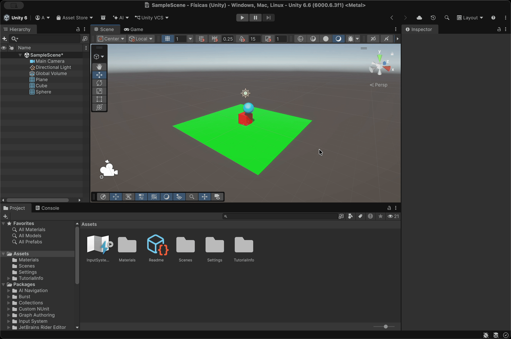
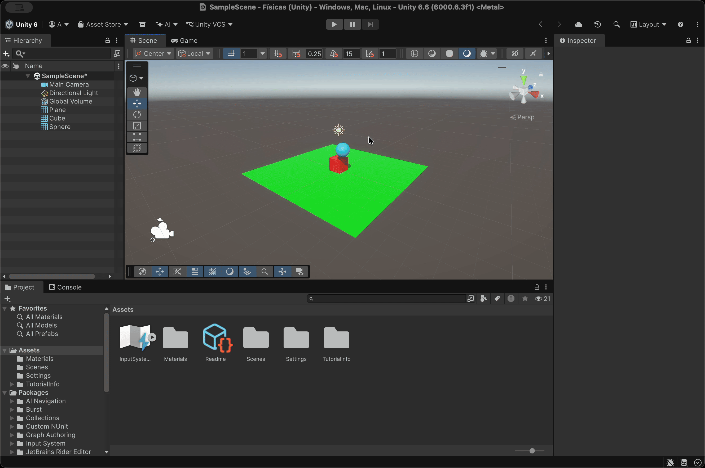
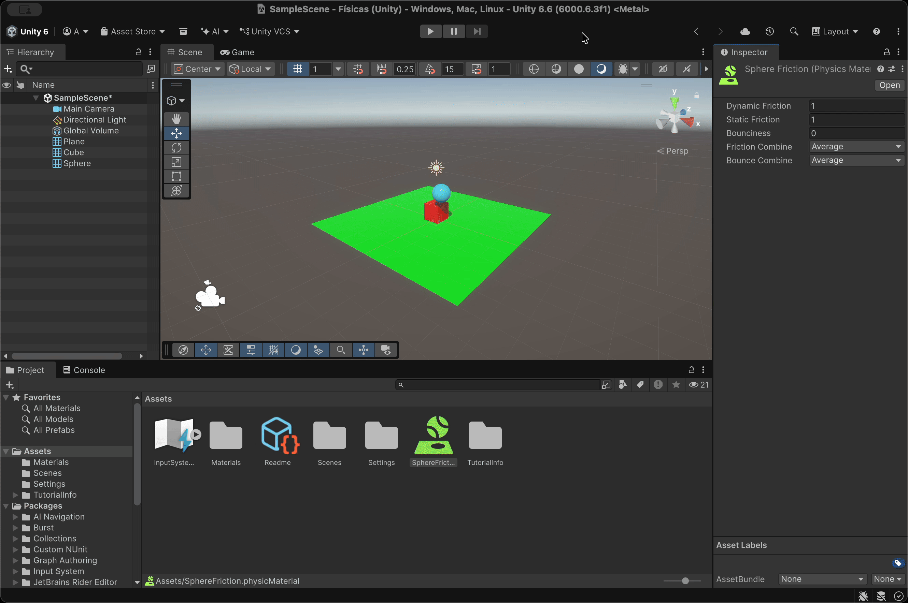
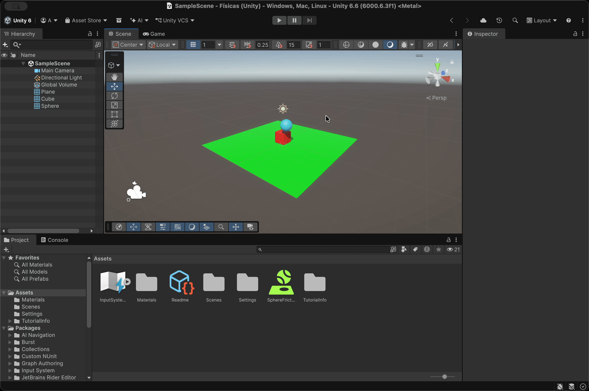
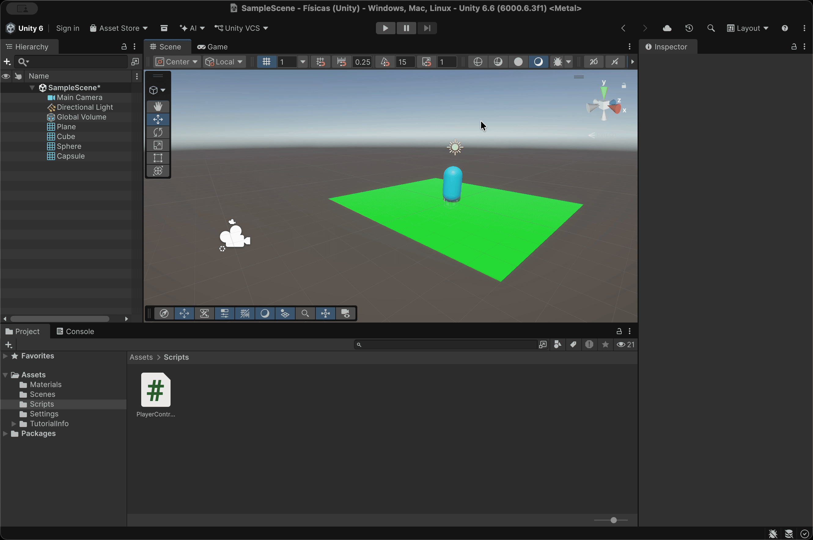
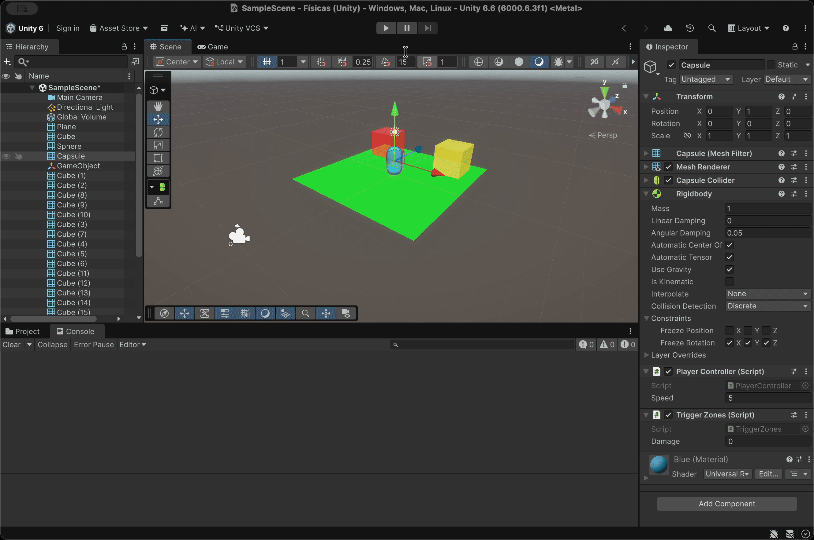
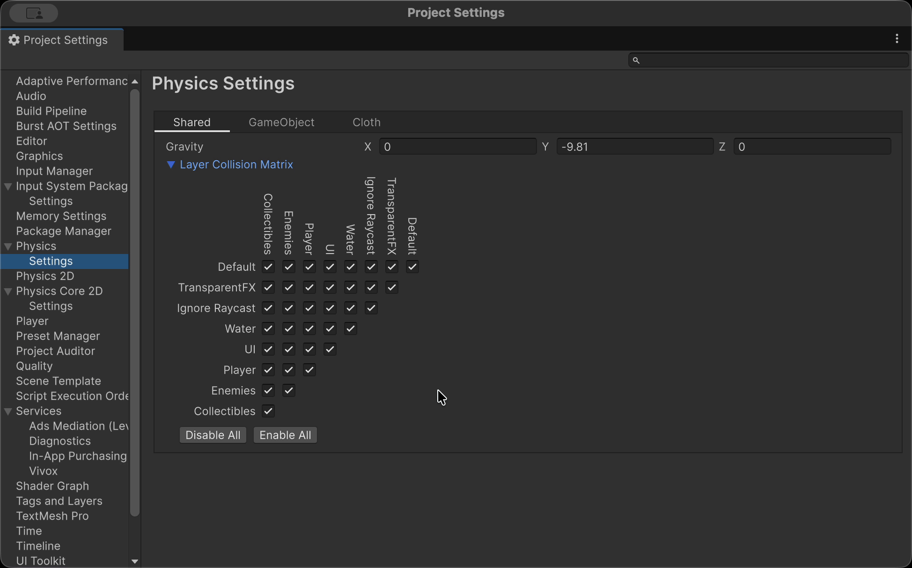
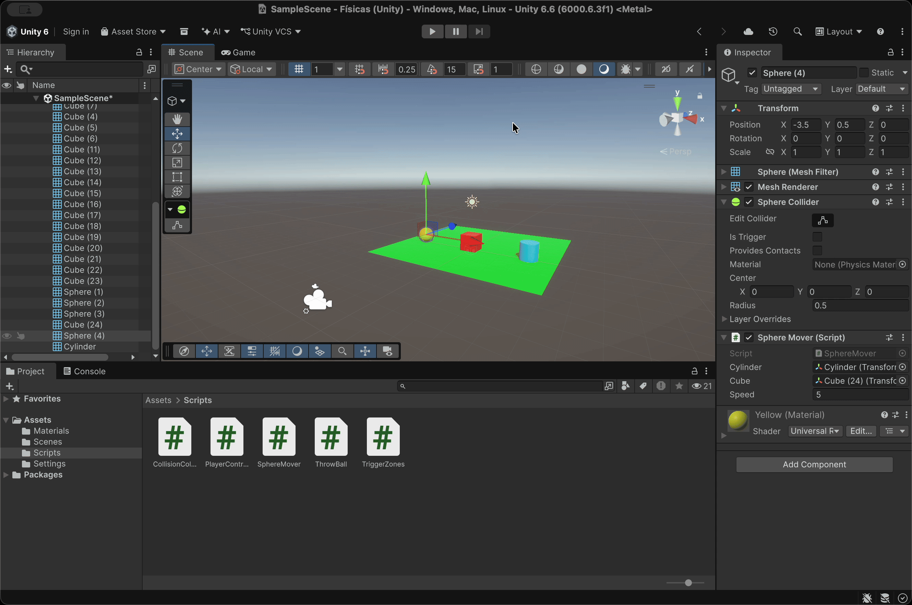

# Práctica 3 - Físicas

**Asignatura:** Interfaces Inteligentes  
**Universidad:** Universidad de La Laguna  
**Titulación:** Grado en Ingeniería Informática  
**Curso:** 2026/2027  
**Fecha:** 15 de octubre de 2026

Repositorio con los experimentos y scripts desarrollados para la práctica de físicas 3D en Unity. La primera parte recoge los experimentos con distintas configuraciones de los componentes **Rigidbody** y **Collider**, explicando los resultados según lo visto en clase. La segunda parte recoge los ejercicios con scripts, cada uno con una descripción de lo implementado, los hitos relevantes y una prueba de ejecución en GIF.

## Estructura del repositorio

```
.
├── docs
│   ├── Ejercicios Introducción a Físicas.pdf
│   └── Introducción a Físicas 3D.pdf
├── gifs
│   ├── situacion1.gif
│   ├── ...
│   ├── situacion9.gif
│   ├── ejercicio_1.gif
│   ├── ...
│   └── ejercicio_6.gif
├── readme.md
└── scripts
    ├── CollisionColor.cs
    ├── PlayerController.cs
    ├── SphereMover.cs
    ├── ThrowBall.cs
    └── TriggerZones.cs
```

## Índice

**Parte 1: Experimentos con Rigidbody y Collider**

- [Situación 1](#situación-1)
- [Situación 2](#situación-2)
- [Situación 3](#situación-3)
- [Situación 4](#situación-4)
- [Situación 5](#situación-5)
- [Situación 6](#situación-6)
- [Situación 7](#situación-7)
- [Situación 8](#situación-8)
- [Situación 9](#situación-9)

**Parte 2: Scripts de físicas**

1. [Ejercicio 1: Personaje controlado con Rigidbody](#ejercicio-1)
2. [Ejercicio 2: Nombre y color al colisionar](#ejercicio-2)
3. [Ejercicio 3: Zonas con Trigger](#ejercicio-3)
4. [Ejercicio 4: Capas y Layer Collision Matrix](#ejercicio-4)
5. [Ejercicio 5: Physic Materials y AddForce](#ejercicio-5)
6. [Ejercicio 6: La esfera alcanza al cilindro](#ejercicio-6)

---

# Parte 1: Experimentos con Rigidbody y Collider

**Escena base:** plano y cámara en las posiciones por defecto, cubo con `y = 0.5` y esfera situada en el aire, ligeramente desplazada respecto al cubo.

## Situación 1

**Configuración**

| Objeto | Componentes |
|--------|-------------|
| Plano | Collider |
| Cubo | Collider + **Rigidbody** |
| Esfera | Collider |

**Resultado:** al darle al *Play* no ocurre nada visible. El cubo permanece sobre el plano y la esfera se queda flotando en el aire.

**Explicación:** el cubo es el único objeto con Rigidbody, así que es el único afectado por la gravedad, pero ya está apoyado sobre el plano (collider estático) y no cae. La esfera no tiene Rigidbody, por lo que el motor de físicas la trata como un objeto estático: la gravedad no actúa sobre ella y se queda en su posición.


## Situación 2

**Configuración**

| Objeto | Componentes |
|--------|-------------|
| Plano | Collider |
| Cubo | Collider + **Rigidbody** |
| Esfera | Collider + **Rigidbody** |

**Resultado:** la esfera cae por la gravedad, impacta en el borde superior del cubo, lo empuja ligeramente en la dirección contraria y acaba rodando por el plano.

**Explicación:** ahora la esfera es un objeto físico y la gravedad la acelera. Como su centro está desplazado respecto al cubo, no se queda encima: al chocar con la arista superior del cubo, el motor de físicas calcula el choque entre ambos Rigidbody (con la misma masa, 1 kg por defecto) y se reparte el impulso. El cubo, al ser empujado, se desplaza o gira un poco, y la esfera sigue rodando hasta frenar por la fricción con el plano.



## Situación 3

**Configuración**

| Objeto | Componentes |
|--------|-------------|
| Plano | Collider |
| Cubo | Collider + **Rigidbody** |
| Esfera | Collider + **Rigidbody** + **Is Kinematic** |

**Resultado:** igual que en la Situación 1, no se mueve nada y la esfera sigue flotando.

**Explicación:** la esfera tiene Rigidbody, pero al ser cinemática la física no la controla: no le afecta la gravedad ni las fuerzas. Visualmente es igual que la Situación 1, pero la diferencia es importante: un objeto cinemático **puede moverse por script o animación** y, al hacerlo, empuja correctamente a los objetos dinámicos (como el cubo), mientras que mover un collider estático (sin Rigidbody) en tiempo de ejecución es ineficiente y no está recomendado.


## Situación 4

**Configuración**

| Objeto | Componentes |
|--------|-------------|
| Plano | Collider + **Rigidbody** |
| Cubo | Collider + **Rigidbody** |
| Esfera | Collider + **Rigidbody** |

**Resultado:** los tres objetos caen indefinidamente hacia abajo, manteniendo prácticamente la misma posición relativa entre ellos.

**Explicación:** al darle Rigidbody (no cinemático) al plano, éste también obedece a la gravedad y cae, ya no actúa como suelo. Como todos los cuerpos caen con la misma aceleración (independientemente de su masa), plano, cubo y esfera caen a la vez sin separarse y no hay choques entre ellos. La esfera sigue sin llegar a golpear al cubo porque ambos caen juntos.


## Situación 5

**Configuración**

| Objeto | Componentes |
|--------|-------------|
| Plano | Collider + **Rigidbody** + **Is Kinematic** |
| Cubo | Collider + **Rigidbody** (masa = 1) |
| Esfera | Collider + **Rigidbody** (masa = 10) |

**Resultado:** el plano se queda fijo. La esfera cae, golpea el borde del cubo y lo empuja ligeramente, y ella apenas se desvía de su trayectoria.

**Explicación:** el plano, al ser cinemático, no cae pero sigue funcionando como suelo sólido. La esfera cae a la misma velocidad que antes (la masa no influye en la caída), pero al chocar, la **masa sí influye**: al tener 10 veces más masa que el cubo, transmite mucho más impulso y sale poco frenada, mientras que el cubo, más ligero, acaba más desplazado y puede incluso volcar.


## Situación 6

**Configuración**

| Objeto | Componentes |
|--------|-------------|
| Plano | Collider + **Rigidbody** + **Is Kinematic** |
| Cubo | Collider + **Rigidbody** (masa = 1) |
| Esfera | Collider + **Rigidbody** (masa = 100) |

**Resultado:** la esfera casi no se ve afectada por el cubo: lo aplasta contra el plano y lo lanza lejos, con un movimiento mucho más brusco que en la Situación 5.

**Explicación:** con una relación de masas de 100 a 1, el cubo es prácticamente un obstáculo "de papel" para la esfera, que conserva casi todo su movimiento y sigue su camino. El cubo recibe un impulso muy grande y sale despedido.



## Situación 7

**Configuración**

| Objeto | Componentes |
|--------|-------------|
| Plano | Collider + **Rigidbody** + **Is Kinematic** |
| Cubo | Collider + **Rigidbody** |
| Esfera | Collider + **Physic Material** + **Rigidbody** |

**Resultado:** el plano se queda fijo. La esfera cae, golpea el borde del cubo y acaba en el plano, igual que en la Situación 2, pero con la fricción alta rueda en vez de deslizar, pierde velocidad mucho antes y se detiene más cerca del punto de impacto. El cubo también acaba menos desplazado, porque la esfera lo arrastra más al rozar con él y transmite menos impulso lateral.

**Explicación:** el plano cinemático actúa como suelo fijo, así que ahora sí hay contacto entre esfera, cubo y plano, y la fricción tiene efecto. La fricción es la fuerza de rozamiento entre las superficies en contacto, y se configura mediante un **Physic Material** (`Dynamic Friction` y `Static Friction`) asignado al collider.



## Situación 8

**Configuración**

| Objeto | Componentes |
|--------|-------------|
| Plano | Collider + **Rigidbody** + **Is Kinematic** |
| Cubo | Collider + **Rigidbody** |
| Esfera | Collider + **Is Trigger** + **Rigidbody** + **Is Kinematic** (no física) |

**Resultado:** no se mueve nada. El cubo sigue sobre el plano y la esfera flota.

**Explicación:** consideramos "no física" a la esfera como cinemática, por lo que no le afecta la gravedad. Además, al ser Trigger, su collider **no es sólido**: cualquier objeto que se mueva hacia ella la atravesaría sin rebotar, y lo único que ocurriría es que se dispararían los eventos `OnTriggerEnter`, `OnTriggerStay` y `OnTriggerExit`. Se cumple la condición para que se lancen eventos de trigger (al menos uno de los objetos tiene Rigidbody).


## Situación 9

**Configuración**

| Objeto | Componentes |
|--------|-------------|
| Plano | Collider + **Rigidbody** + **Is Kinematic** |
| Cubo | Collider + **Rigidbody** |
| Esfera | Collider + **Is Trigger** + **Rigidbody** |

**Resultado:** la esfera cae, atraviesa el cubo y el plano sin ser frenada y sigue cayendo indefinidamente. El cubo no se mueve.

**Explicación:** la esfera es física, así que la gravedad la acelera. Pero al ser Trigger no genera colisión sólida: pasa a través del cubo y del plano sin empujarlos ni rebotar. Lo único que sucede son los **eventos de trigger**: se llama a `OnTriggerEnter` al entrar en el cubo y en el plano, `OnTriggerStay` mientras los atraviesa y `OnTriggerExit` al salir.



---

# Parte 2: Scripts de físicas

<a id="ejercicio-1"></a>
## Ejercicio 1: Personaje controlado con Rigidbody

**Script:** [`PlayerController.cs`](./scripts/PlayerController.cs)

**Qué hace:** mueve un personaje con las teclas `W`, `A`, `S`, `D` o las flechas, usando su `Rigidbody`, pero manteniendo el control total sobre el movimiento: el personaje avanza a la velocidad configurada y se detiene en cuanto se sueltan las teclas, sin inercia ni deslizamiento.

**Hitos relevantes:**
- La entrada se lee en `Update()` con `Input.GetAxisRaw("Horizontal")` y `Input.GetAxisRaw("Vertical")`, que devuelven directamente -1, 0 o 1 (sin suavizado), y se guarda en un `Vector3` (`direction`).
- El vector se normaliza con `.normalized` para que la velocidad en diagonal sea la misma que en línea recta.
- El movimiento se aplica en `FixedUpdate()`, que es donde Unity actualiza la física, con `rb.MovePosition(rb.position + direction * speed * Time.fixedDeltaTime)`.
- Mover el Rigidbody con `MovePosition` en lugar de modificar `transform.position` permite que el motor de físicas tenga en cuenta las colisiones durante el desplazamiento.
- `speed` es público y se ajusta desde el inspector.

**Prueba de ejecución:**



<a id="ejercicio-2"></a>
## Ejercicio 2: Nombre y color al colisionar

**Script:** [`CollisionColor.cs`](./scripts/CollisionColor.cs)

**Qué hace:** en la escena hay varios cubos y esferas con `Rigidbody` dinámico. Cuando uno de ellos colisiona con otro objeto, muestra por consola su nombre y el del objeto con el que ha chocado, y cambia su color a uno aleatorio.

**Hitos relevantes:**
- La detección se hace en `OnCollisionEnter(Collision collision)`, que se llama una única vez al comenzar el contacto.
- El nombre del otro objeto se obtiene con `collision.gameObject.name` y se muestra con `Debug.Log`.
- Se ignoran las colisiones con el suelo comprobando la etiqueta con `collision.gameObject.CompareTag("Floor")`, de modo que los objetos no cambian de color simplemente por caer. Es necesario etiquetar el suelo con `Floor`.
- El color nuevo se genera con `new Color(Random.value, Random.value, Random.value)` y se asigna con `GetComponent<Renderer>().material.color`.
- El script se añade a cada objeto que debe reaccionar.

**Prueba de ejecución:**


<a id="ejercicio-3"></a>
## Ejercicio 3: Zonas con Trigger

**Script:** [`TriggerZones.cs`](./scripts/TriggerZones.cs)

**Qué hace:** el personaje interactúa con dos zonas (cubos grandes con `Is Trigger` activado). Al entrar en la zona de color, el personaje cambia a naranja y al salir recupera su color original. Al entrar en la zona de daño, se incrementa una variable `damage`.

**Hitos relevantes:**
- El script se coloca en el **personaje**, no en las zonas, y las zonas se distinguen mediante etiquetas: `ColorZone` y `DamageZone`.
- En `Start()` se guarda el color original del material para poder revertirlo después.
- `OnTriggerEnter(Collider collider)` comprueba la etiqueta con `collider.CompareTag(...)`: si es `ColorZone` cambia el color a `Color.orange`, y si es `DamageZone` suma 10 a `damage` y lo muestra por consola.
- `OnTriggerExit(Collider collider)` restaura el color original al salir de la zona de color.
- `damage` es una variable pública, por lo que se puede ver cómo aumenta en el inspector.
- Para que se lancen los eventos de trigger, el personaje debe tener `Rigidbody` (como se vio en las Situaciones 8 y 9).

**Prueba de ejecución:**



<a id="ejercicio-4"></a>
## Ejercicio 4: Capas y Layer Collision Matrix

**Script:** no requiere un script nuevo; se resuelve configurando capas y la matriz de colisiones en el editor.

**Qué hace:** se crean tres tipos de objetos en capas distintas (jugador, enemigos y recolectables) y se configura qué capas pueden interactuar entre sí.

**Hitos relevantes:**
- Se crean las capas `Player`, `Enemy` y `Collectible` desde *Tags and Layers* y se asigna cada una a sus objetos.
- Se abre *Edit → Project Settings → Physics → Layer Collision Matrix* y se configura:
  - **Enemigos:** solo se deja marcada la interacción `Enemy` ↔ `Player`; se desmarcan el resto (entre enemigos, con recolectables, etc.), de modo que solo colisionan con el jugador.
  - **Recolectables:** sus colliders tienen `Is Trigger` activado, así que no generan colisión sólida y solo se detectan mediante eventos `OnTriggerEnter`. Solo interactúan con el jugador.
- La matriz actúa como filtro previo: si dos capas no están marcadas, el motor de físicas ni siquiera comprueba el contacto entre ellas, lo que además es más eficiente.

**Prueba de ejecución:**



<a id="ejercicio-5"></a>
## Ejercicio 5: Physic Materials y AddForce

**Script:** [`ThrowBall.cs`](./scripts/ThrowBall.cs)

**Qué hace:** en la escena hay varios objetos con distintos **Physic Materials** (resbaladizo, rugoso y de rebote alto). Al pulsar la tecla `X`, se les aplica una fuerza con `AddForce()` para comparar cómo reacciona cada uno.

**Hitos relevantes:**
- Se crean tres Physic Materials desde *Create → Physic Material* y se asignan al campo `Material` del collider de cada objeto:
  - **Resbaladizo:** fricción dinámica y estática próximas a 0, de modo que el objeto desliza con muy poco rozamiento.
  - **Rugoso:** fricción alta, de modo que el objeto frena enseguida.
  - **Rebote alto:** `Bounciness` cercano a 1, de modo que el objeto rebota casi sin perder energía.
- La pulsación se detecta en `Update()` con `Input.GetKeyDown(KeyCode.X)`, para lanzar una sola vez por pulsación.
- El lanzamiento se hace con `rb.AddForce(Vector3.forward * speed, ForceMode.Impulse)`: `ForceMode.Impulse` aplica la fuerza de golpe, teniendo en cuenta la masa del objeto.
- `speed` es público y se ajusta desde el inspector. El script se añade a cada objeto lanzado, que necesita `Rigidbody`.
- Con el mismo impulso inicial, el objeto resbaladizo llega más lejos, el rugoso se detiene antes y el de rebote alto vuelve a saltar tras cada impacto.

**Prueba de ejecución:**


<a id="ejercicio-6"></a>
## Ejercicio 6: La esfera alcanza al cilindro

**Script:** [`SphereMover.cs`](./scripts/SphereMover.cs)

**Qué hace:** en la escena hay un cubo, una esfera y un cilindro alineados, los tres con `Collider` pero **sin** `Rigidbody`. El cilindro es el objetivo de la esfera y el cubo hace de obstáculo entre ambos. La esfera se dirige hacia el cilindro y, cuando alcanza al cubo, este cambia de color.

**Hitos relevantes:**
- Las referencias `cylinder` y `cube` son públicas y se asignan desde el inspector, igual que `speed`.
- En `Update()`, `transform.LookAt(cylinder)` orienta la esfera hacia el objetivo y `transform.Translate(Vector3.forward * speed * Time.deltaTime)` la hace avanzar en su propia dirección frontal, de forma independiente de los frames por segundo.
- Como ninguno de los objetos tiene `Rigidbody`, no se generan eventos de colisión ni de trigger: el contacto con el cubo se detecta calculando la distancia con `Vector3.Distance(transform.position, cube.position) < 1f`.
- El cambio se aplica con `cube.GetComponent<Renderer>().material.color = Color.orange`.
- La variable `is_changed` evita repetir el cambio en cada frame una vez realizado.
- Al no haber física, la esfera atraviesa el cubo y continúa hasta el cilindro.

**Prueba de ejecución:**


